# Stage 2 feature evidence

Original requirements below are summaries of the supplied Stage 2 report’s Stage 1 mapping, not verbatim Stage 1 specifications (the original Stage 1 file was not supplied). Screenshots were captured from the running application using synthetic data and automated GUI actions. F01/F03/F04/F11 use an offline test double, not a live API. F10 displays the actual reminder callback text in an automated capture window; F12 shows the export controls after a successful file creation.

## F01 — Natural-language agent interaction

**Original requirement (summary):** Natural-language agent interaction.

**Implementation:** IntentInterpreter and ToolManager select and execute read-only commands.

**Changes and rationale:** Writes require explicit user action to avoid unintended mutations.

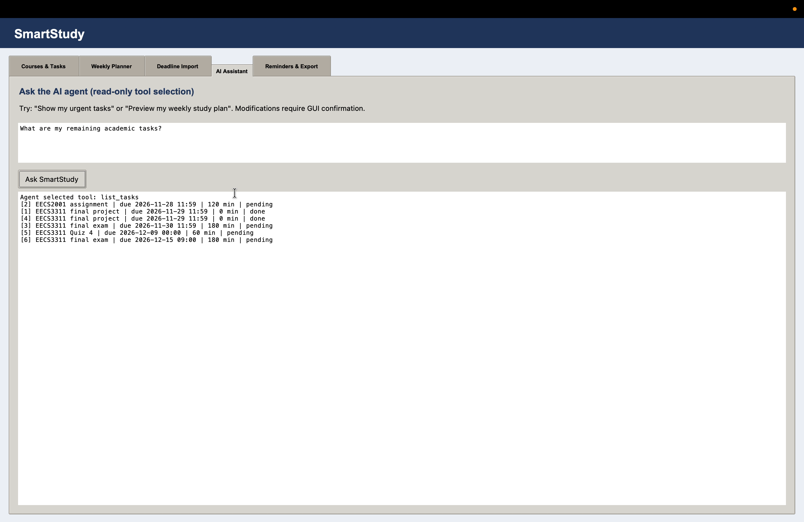

## F02 — Manage courses and tasks

**Original requirement (summary):** Manage courses and tasks.

**Implementation:** AgentController validates input and SQLiteRepository persists records.

**Changes and rationale:** No deviation identified in supplied report.

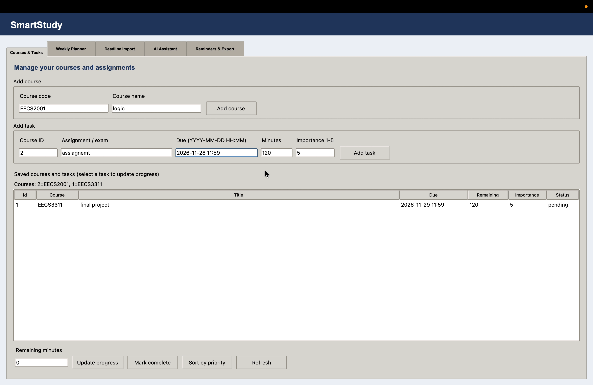

## F03 — Import deadlines from PDF outlines

**Original requirement (summary):** Import deadlines from PDF outlines.

**Implementation:** DocumentProcessor extracts selectable text; DeadlineExtractor returns drafts for confirmation.

**Changes and rationale:** Explicit validation and confirmation prevent ambiguous dates being saved; scanned PDFs unsupported.

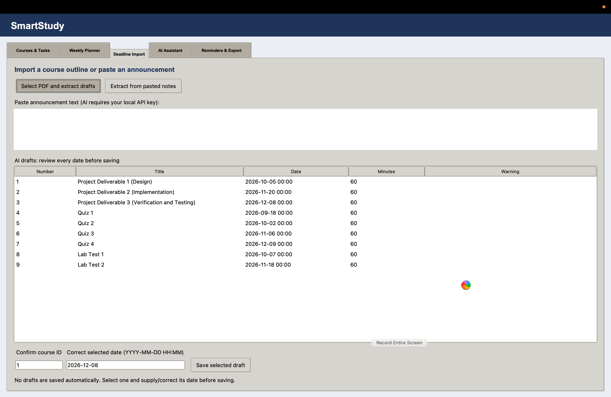

## F04 — Extract deadlines from notes

**Original requirement (summary):** Extract deadlines from notes.

**Implementation:** DeadlineExtractor creates DraftTask candidates; user confirms dates.

**Changes and rationale:** Explicit confirmation prevents ambiguous dates being saved.

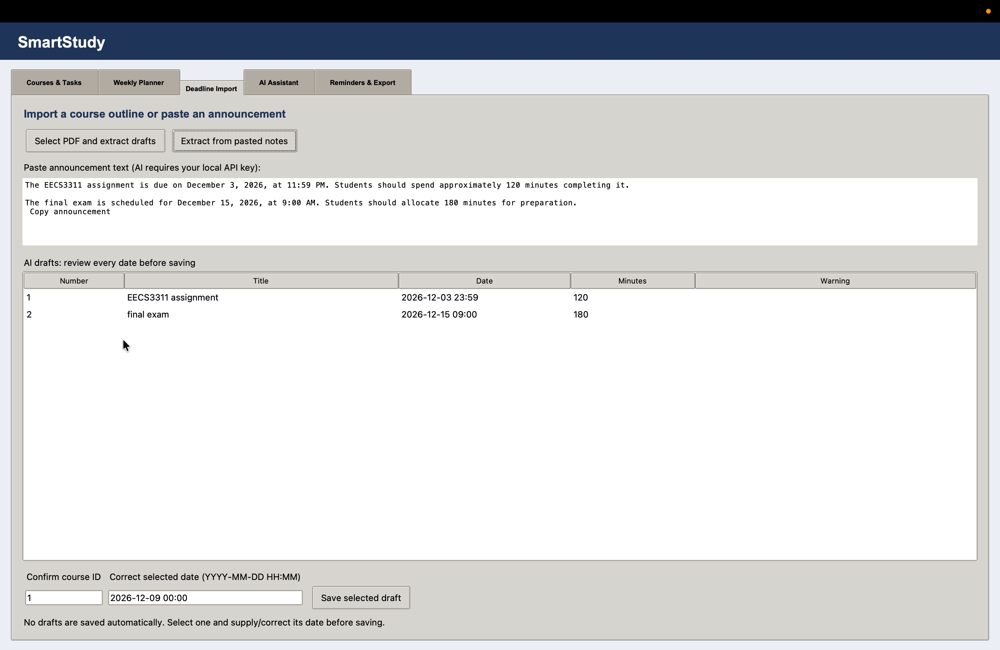

## F05 — Rank tasks by priority

**Original requirement (summary):** Rank tasks by priority.

**Implementation:** PriorityEngine uses deadline or balanced Strategy.

**Changes and rationale:** No deviation identified in supplied report.

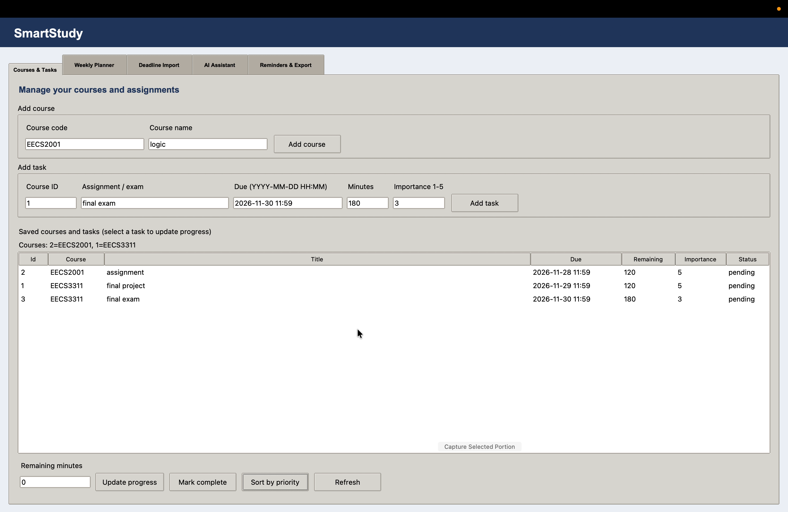

## F06 — Generate weekly study plans

**Original requirement (summary):** Generate weekly study plans.

**Implementation:** SchedulePlanner allocates free intervals; approval persists sessions.

**Changes and rationale:** One daily availability window plus fixed commitments simplifies deterministic allocation.

## F07 — Avoid scheduling conflicts

**Original requirement (summary):** Avoid scheduling conflicts.

**Implementation:** ConflictChecker checks overlaps and fixed commitments.

**Changes and rationale:** No deviation identified in supplied report.

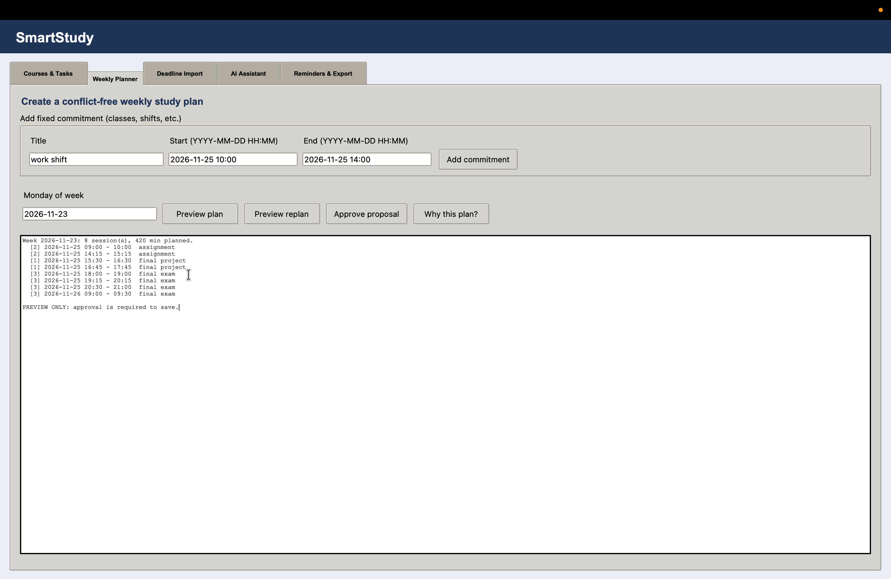

## F08 — Track task progress

**Original requirement (summary):** Track task progress.

**Implementation:** AgentController updates remaining effort and publishes task events.

**Changes and rationale:** No deviation identified in supplied report.

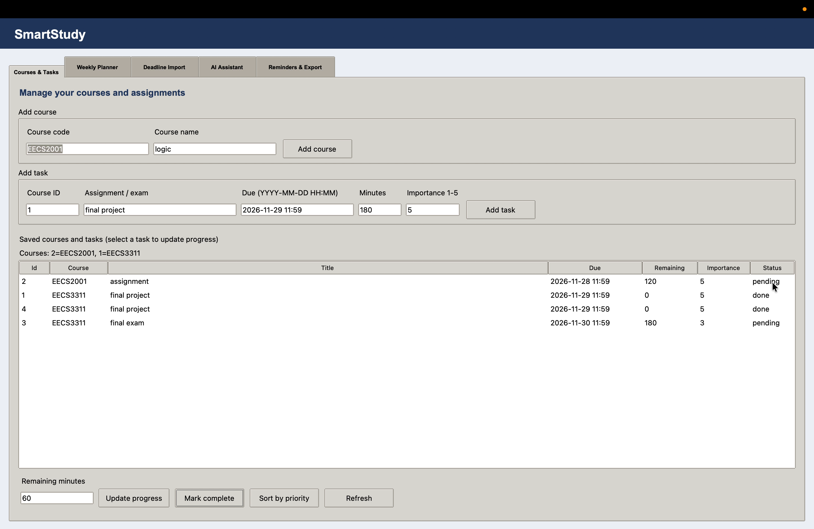

## F09 — Replan after changes

**Original requirement (summary):** Replan after changes.

**Implementation:** SchedulePlanner previews replacements; incomplete replacements preserve saved plan.

**Changes and rationale:** No deviation identified in supplied report.

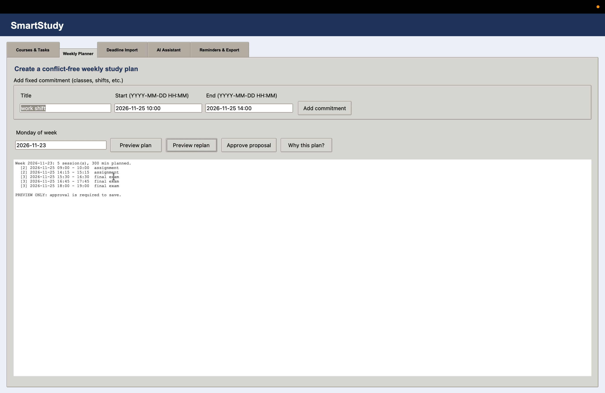

## F10 — Deliver deadline reminders

**Original requirement (summary):** Deliver deadline reminders.

**Implementation:** ReminderScheduler checks deadlines and suppresses duplicate deliveries.

**Changes and rationale:** Local GUI/CLI callbacks replace external notifications to avoid provider credentials.

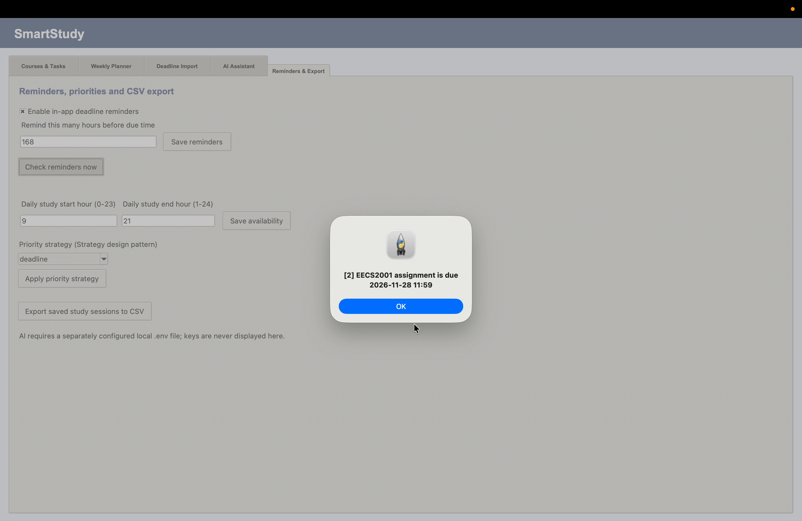

## F11 — Explain study plans

**Original requirement (summary):** Explain study plans.

**Implementation:** ExplanationService uses schedule facts and LLM with deterministic fallback.

**Changes and rationale:** Fallback keeps explanations available offline.

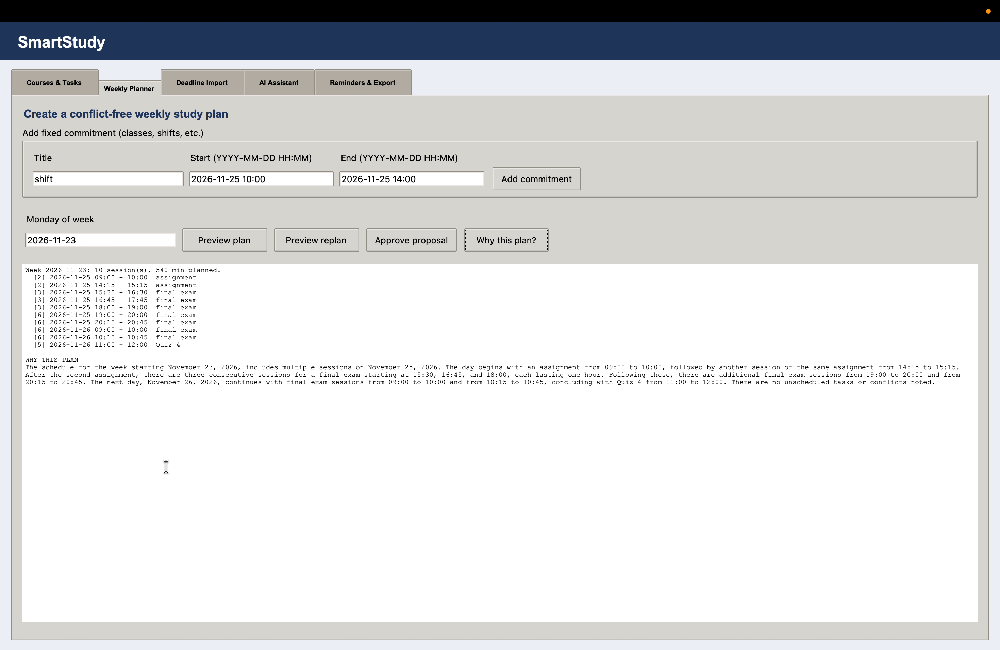

## F12 — Export study sessions and support CLI

**Original requirement (summary):** Export study sessions and support CLI.

**Implementation:** AgentController writes CSV; argparse CLI shares services with GUI.

**Changes and rationale:** CSV writer resides in controller rather than separate ExportService to reduce boilerplate.

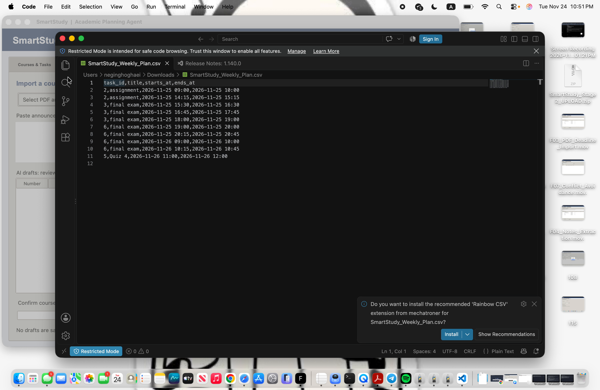

## Matched GUI and CLI task

See the [new recording index](../demos/README.md) for the GUI/CLI demonstration and verification caveats.

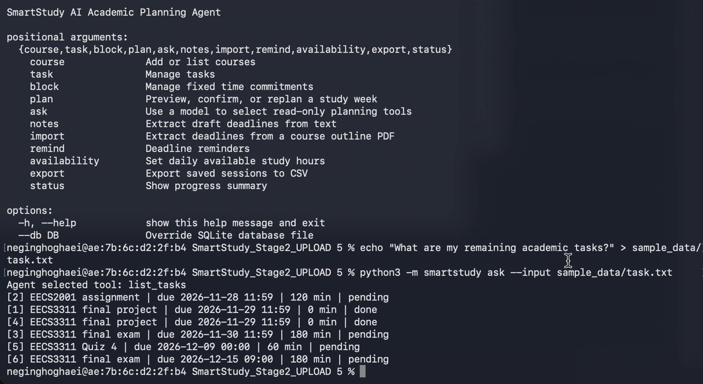

User recordings show AI outputs; identical GUI/CLI tool selection and provider costs remain unverified.
